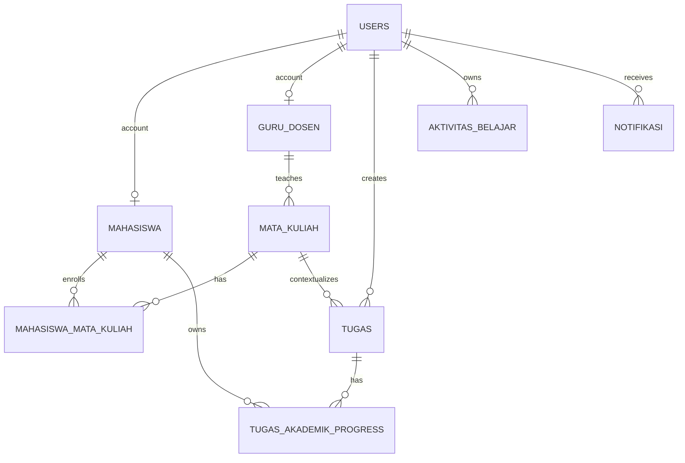

# 06 — DATABASE DESIGN

| Metadata | Value |
|---|---|
| Document ID | DOC-06 |
| Version | 1.2.0 |
| Status | Draft — requires schema reconciliation |
| Database | MySQL |
| Database name | `db_manajemen_akademik` |

## 1. Purpose and principles

This document describes the logical relational model for the web application. The original six assignment entities are retained conceptually and extended to support accounts, roles, enrollment, academic progress, and notifications.

The exact final DDL must be generated only after open decisions and consistency review. Do not treat this document as an executed migration.

Principles:
- MySQL is the central source of truth.
- Laravel handles application validation and orchestration.
- Foreign keys and unique constraints protect integrity.
- Historical progress must not be cascaded away.
- Archive rather than destructive deletion where approved.
- No local Room database or synchronization metadata.
- Avoid universal `row_version`; concurrency is evaluated by entity/operation.

## 2. Entity inventory

| Table | Purpose |
|---|---|
| `users` | Authentication account, username, password hash, role, active state |
| `mahasiswa` | Student profile and NPM |
| `guru_dosen` | Lecturer profile and NIP |
| `mata_kuliah` | Course master and assigned lecturer |
| `prioritas` | Priority reference |
| `status_tugas` | Task/progress status reference |
| `status_belajar` | Study activity status reference |
| `tugas` | Shared task definition table with personal/academic discriminator |
| `aktivitas_belajar` | Student-owned study activity |
| `mahasiswa_mata_kuliah` | Student-course enrollment |
| `tugas_akademik_progress` | Per-student progress for academic task |
| `notifikasi` | Persisted in-app notifications |
| `notifikasi_preferensi` | Per-user notification preferences, if enabled |

## 3. Logical relationships

The diagram is logical; optional/conditional relationships depend on task type and must be represented in constraints and application validation.

## 4. Table definitions — logical baseline

### 4.1 `users`
Expected fields:
- `id_user` BIGINT UNSIGNED PK.
- `username` unique, required.
- `password` hash, required.
- `role` restricted to `mahasiswa`, `guru_dosen`, `admin`.
- `is_active` boolean.
- nullable profile reference(s) for Mahasiswa/Guru/Dosen according to the selected profile model.
- timestamps.

Do not add email as a login identifier. Lecturer contact email, if retained as profile data, is not a login identifier. Exact profile mapping and whether Laravel's default `users` columns are adapted must be resolved before migrations.

### 4.2 `mahasiswa`
- `id_mahasiswa` PK.
- `npm` unique.
- `nama_lengkap`.
- `is_archived` boolean and `tanggal_arsip` nullable where archive rule applies.
- timestamps.

### 4.3 `guru_dosen`
- `id_guru_dosen` PK.
- `nip_guru` unique (exact naming/nullable policy to verify).
- name and lecturer profile fields.
- timestamps.

### 4.4 `mata_kuliah`
- `id_mata_kuliah` PK.
- `kode_mata_kuliah` unique.
- `nama_mata_kuliah`.
- `guru_dosen_id` FK, required: exactly one lecturer per course.
- `is_archived`, `tanggal_arsip`.
- timestamps.

There is no `course_teacher` junction table. There is no duplicated `dosen_pengampu` free-text field; lecturer display is derived through the FK relationship.

### 4.5 Reference tables
`prioritas`: `id_prioritas`, `nama_prioritas`; values Rendah, Sedang, Tinggi.

`status_tugas`: `id_status`, `nama_status`; values Belum Dikerjakan, Sedang Dikerjakan, Selesai.

`status_belajar`: `id_status_belajar`, `nama_status`; values Direncanakan, Sedang Berlangsung, Selesai.

Do not add percentage progress, grade, checklist, submission, or other status values without approval.

### 4.6 `tugas`
Logical fields:
- `id_tugas` PK.
- `id_mata_kuliah` nullable for personal task; required for academic task.
- `id_prioritas` required.
- `id_status` required for personal task; null for academic task definition.
- `id_user` creator account.
- `id_pembuat_guru_dosen` required for academic task, null for personal task.
- `id_mahasiswa_pemilik` required for personal task, null for academic task.
- `task_type` enum/discriminator `personal` or `academic`.
- `judul_tugas`, `deskripsi`, `deadline`.
- `is_closed` for academic task.
- `is_archived`, `tanggal_arsip`.
- timestamps.

Rules:
- Personal: owned by Mahasiswa, course optional, has task status.
- Academic: authored by Guru/Dosen, course required and must be taught by that lecturer; task definition is shared.
- Academic priority default is `Sedang`; lecturer may change it.
- The creator account and profile must refer to the same actor. Laravel validates this cross-table rule.
- A MySQL CHECK may enforce row-local task type conditions, but cross-table ownership needs application/service validation and integration tests.

### 4.7 `aktivitas_belajar`
- `id_aktivitas` PK.
- `id_mata_kuliah` nullable.
- `id_status_belajar` required.
- `id_user` required FK to owner account.
- `judul_aktivitas`, `materi_belajar`, `waktu_mulai`, `durasi_menit`, `tanggal_dibuat`.
- `USER-DECIDED` (REC-02, 2026-11-18): agar konsisten dengan `tugas.id_mahasiswa_pemilik`, ownership diseragamkan menjadi `id_mahasiswa` FK ke `mahasiswa`, dengan validasi bahwa akun terkait berrole `mahasiswa`.
- `is_archived`, `tanggal_arsip`.
- timestamps.
- `durasi_menit > 0`.
- Owner must be Mahasiswa.

### 4.8 `mahasiswa_mata_kuliah`
- `id_mahasiswa_mata_kuliah` PK.
- `id_mahasiswa` FK.
- `id_mata_kuliah` FK.
- `tahun_akademik` (e.g. `2026/2027`).
- `semester` Ganjil/Genap.
- `tanggal_daftar`.
- `status`: Terdaftar, Ditolak, Dibatalkan, Selesai.
- timestamps.

Unique: `(id_mahasiswa, id_mata_kuliah, tahun_akademik, semester)`.

Lifecycle:
- Dibatalkan and Selesai rows are retained.
- Only Terdaftar receives new academic task progress.
- Same-period re-enrollment reactivates existing row and updates registration date.
  - `USER-DECIDED` (REC-05, 2026-11-18): jangan menimpa `tanggal_daftar` pada reaktivasi; pertahankan tanggal pendaftaran pertama dan catat waktu reaktivasi pada `updated_at`.
- Different period creates a new row.
- Leaving a course does not erase academic progress.

### 4.9 `tugas_akademik_progress`
- `id_progress` PK.
- `id_tugas` FK to academic task definition.
- `id_mahasiswa` FK.
- `id_status` FK to `status_tugas`.
- `id_user_diubah_oleh` FK to `users`.
- `tanggal_ubah`, timestamps.

Unique: `(id_tugas, id_mahasiswa)`.

Rules:
- One progress record per student per academic task.
- Initial status Belum Dikerjakan.
- Student may update own progress.
- Lecturer may correct progress only for courses they teach.
- Record the account that last changed the progress.
- Progress mutation never modifies the task definition.
- Admin monitoring is read-only.

### 4.10 `notifikasi`
- `id_notifikasi` PK.
- `id_user` recipient FK.
- `tipe`, `judul`, `pesan`.
- `resource_type`, `resource_id` optional polymorphic reference.
- `is_read`, `read_at`.
- `dedup_key`, dengan unique **`(id_user, dedup_key)`** (`USER-DECIDED`, REC-01, 2026-11-18). Unique global akan menolak notifikasi penerima kedua pada satu event distribusi, sehingga cakupan per penerima diperlukan.
- `tanggal_dibuat`, timestamps.

Only the recipient may read or mark a notification as read. Admin cannot inspect another user's notification content.

### 4.11 `notifikasi_preferensi`
- `id_notifikasi_preferensi` PK.
- `id_user` FK.
- `tipe`.
- `is_enabled`.
- `updated_at`.
- Unique `(id_user, tipe)`.

Existence and exact preference types depend on final notification policy; if no per-user preference feature is approved, this table may be deferred.

## 5. Referential integrity

Use `BIGINT UNSIGNED` consistently for PK/FK pairs if retained from the existing schema. Use restrictive delete behavior where deleting a parent could remove academic history. Avoid `ON DELETE CASCADE` for progress and enrollment history.

Expected important FK relationships:
- `mata_kuliah.guru_dosen_id` → `guru_dosen.id_guru_dosen`.
- `tugas.id_mata_kuliah` → `mata_kuliah.id_mata_kuliah`.
- `tugas.id_prioritas` → `prioritas.id_prioritas`.
- `tugas.id_status` → `status_tugas.id_status`.
- `aktivitas_belajar.id_user` → `users.id_user`.
- `mahasiswa_mata_kuliah` → `mahasiswa`, `mata_kuliah`.
- `tugas_akademik_progress` → `tugas`, `mahasiswa`, `status_tugas`, `users`.
- `notifikasi.id_user` → `users`.

## 6. Indexes

Recommended candidates; validate with query plans and actual access patterns:
- `users(username)` unique.
- `mahasiswa(npm)` unique.
- `guru_dosen(nip_guru)` unique.
- `mata_kuliah(kode_mata_kuliah)` unique.
- `mata_kuliah(guru_dosen_id, is_archived)`.
- `tugas(id_mahasiswa_pemilik, task_type, is_archived)`.
- `tugas(id_pembuat_guru_dosen, task_type, is_closed, is_archived)`.
- `tugas(id_mata_kuliah, task_type, is_closed, is_archived)`.
- `aktivitas_belajar(id_user, is_archived, waktu_mulai)`.
- enrollment unique composite plus indexes by student/status and course/status.
- progress unique composite plus index by task and by student.
- notification `(id_user, is_read, tanggal_dibuat)`.
- notification dedup key unique.

## 7. Concurrency policy — per data type

Do not add `row_version` to all tables by default.

| Entity/operation | Baseline protection | Optimistic locking? |
|---|---|---|
| Student personal task update | ownership check + validation + transaction | Evaluate if concurrent edit risk is demonstrated |
| Academic task definition | lecturer-course policy + transaction | Evaluate for concurrent edits/close |
| Academic progress | unique key + atomic update + transaction | Consider for simultaneous student/lecturer updates |
| Enrollment create/reactivate | composite unique key + transaction + idempotent handling | Usually not required initially |
| Academic task distribution | transaction + unique `(id_tugas,id_mahasiswa)` + insert-ignore/upsert semantics without overwriting status | Not required for dedup |
| Study activity | ownership + validation + transaction | Evaluate if lost-update risk is demonstrated |
| Notification read state | atomic update constrained by recipient | Not required initially |
| Archive flags | guarded state transition + transaction | Evaluate only if concurrent archive/edit conflict matters |

Final decision requires testing race conditions. `updated_at` is not itself an optimistic-lock token.

## 8. Data lifecycle and archival

- Student, course, task, and study activity archive flags must follow the approved lifecycle.
- Archive must preserve enrollment and progress history.
- Hard deletion must be blocked where it breaks audit/history or restrictive FKs.
- Completed status is not equivalent to archive.
- Closed academic task is not equivalent to archived task.
- Course archive stops new distribution.
- Student archive prevents new distribution while preserving history.

## 9. Transaction boundaries

Use transactions for:
1. Student registration + profile + account creation.
2. Lecturer account + profile creation.
3. Course create/update and lecturer assignment.
4. Enrollment create/reactivation + late task progress distribution.
5. Academic task create + initial progress distribution + notification event creation.
6. Academic task close.
7. Progress correction.
8. Archive operations affecting related state.

External side effects (email/push) are out of MVP. Scheduler notifications should be created in DB transaction-safe jobs with deduplication.

## 10. Seed data

Reference seed values:
- Prioritas: Rendah, Sedang, Tinggi.
- Status tugas: Belum Dikerjakan, Sedang Dikerjakan, Selesai.
- Status belajar: Direncanakan, Sedang Berlangsung, Selesai.
- Roles: mahasiswa, guru_dosen, admin.

Initial Admin provisioning must be secure and not rely on a public registration endpoint.

## 11. Open database decisions

- Profile/account mapping and exact `users` schema.
- Temporary password lifecycle fields/flags.
- Whether `notifikasi_preferensi` is MVP.
- Final `row_version` decision for academic progress and task definition.
- Exact soft archive columns and affected entities.
- Exact column names/types/lengths, timestamp timezone policy.
- MySQL version and CHECK constraint enforcement.
- Final ERD and DDL audit.

## 12. Rekonsiliasi skema (2026-11-18, `PROPOSED`)

Audit menemukan konflik dan celah berikut. Semua butir berstatus `PROPOSED` atau `OPEN`; tidak satu pun mengubah definisi `USER-DECIDED`. Migration final tetap menunggu CP2.

| ID | Temuan | Penyelesaian | Status |
|---|---|---|---|
| REC-01 | `dedup_key` unique global vs event multi-penerima | Unique komposit `(id_user, dedup_key)` | `USER-DECIDED` (2026-11-18) |
| REC-02 | `tugas` memakai `id_mahasiswa_pemilik`, `aktivitas_belajar` memakai `id_user` | Ownership data personal diseragamkan ke `mahasiswa` | `USER-DECIDED` (2026-11-18) |
| REC-03 | PK `id_*` menyimpang dari default Laravel | Nama PK/FK dokumen dipertahankan sebagai `$primaryKey` eksplisit | `USER-DECIDED` (2026-11-18) |
| REC-04 | Status `Ditolak`/`Selesai` tanpa alur transisi | Belum ada aturan transisi eksplisit; tetap `OPEN` (`PRD-TBD-022`) | `OPEN` |
| REC-05 | `tanggal_daftar` ditimpa saat reaktivasi | Pertahankan tanggal pertama, reaktivasi lewat `updated_at` | `USER-DECIDED` (2026-11-18) |
| REC-06 | `is_active` akun vs `is_archived` profil tidak terhubung | Arsip profil mahasiswa menonaktifkan akun; `guru_dosen` memiliki flag archive | `USER-DECIDED` (2026-11-18) |
| REC-12 | Kebijakan 403 vs 404 belum ditetapkan | 404 untuk resource milik pengguna lain; 403 untuk penolakan role | `USER-DECIDED` (2026-11-18) |
| REC-13 | Timezone penyimpanan/tampilan belum ditetapkan | Simpan UTC, tampilkan `Asia/Jakarta` | `USER-DECIDED` (2026-11-18) |
| REC-14 | Nullability `deadline` | Wajib untuk tugas personal dan akademik | `USER-DECIDED` (2026-11-18) |
| REC-15 | Versi runtime belum dikunci | Laravel 12.x, PHP 8.4, MySQL 8.4 LTS, Bootstrap 5.3, Bootstrap Icons | `USER-DECIDED` (2026-11-18) |

Catatan environment: fondasi Phase 2 dijalankan pada PHP 8.4.24 dan server database lokal MariaDB 11.8.5 karena MySQL Server belum tersedia di mesin pengembangan. Build produksi tetap menargetkan MySQL sesuai baseline; perbedaan ini harus diverifikasi ulang sebelum migration final.
