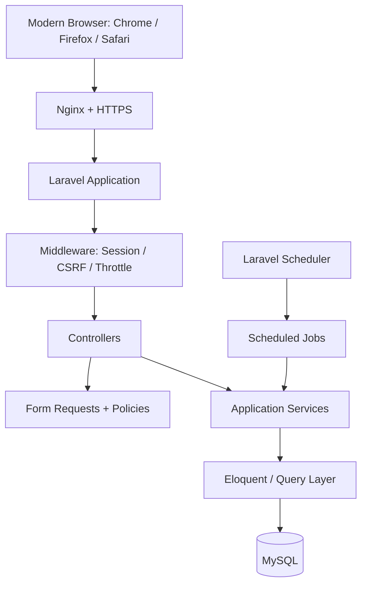
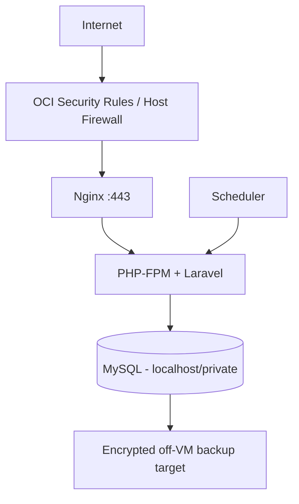

# 07 — SYSTEM ARCHITECTURE

| Metadata | Value |
|---|---|
| Document ID | DOC-07 |
| Version | 1.1.0 |
| Status | Draft |
| Architecture | Laravel Full-Stack Monolith |
| Deployment | One OCI VM |

## 1. Purpose and scope

Defines the web application's logical architecture, component responsibilities, request flow, security boundaries, scheduling, and deployment target.

## 2. Architecture decisions

| ID | Decision | Status |
|---|---|---|
| ARCH-001 | Web Application only | USER-DECIDED |
| ARCH-002 | Laravel Blade frontend | USER-DECIDED |
| ARCH-003 | Laravel Full-Stack single application | USER-DECIDED |
| ARCH-004 | MySQL central database | USER-DECIDED / existing baseline |
| ARCH-005 | Session authentication | USER-DECIDED |
| ARCH-006 | Online-first | USER-DECIDED |
| ARCH-007 | Web Routes first; JSON API only as needed | USER-DECIDED |
| ARCH-008 | One OCI VM for Nginx, Laravel, MySQL | USER-DECIDED |
| ARCH-009 | Bootstrap | USER-DECIDED |
| ARCH-010 | Laravel Scheduler for in-app reminder jobs | USER-DECIDED |

## 3. High-level architecture



Browser requests do not connect directly to MySQL. MySQL must listen only on a private/local interface.

## 4. Application structure

Proposed logical layers:
1. Routes: web route definitions and middleware groups.
2. Middleware: session, CSRF, throttling, request context.
3. Form Requests: input validation and normalization.
4. Policies/Gates: role, ownership, resource relationship.
5. Controllers: HTTP orchestration and response selection.
6. Services/Actions: business operations and transactions.
7. Models/Queries: persistence and query composition.
8. Blade: server-rendered views and reusable components.

Do not create layers that add ceremony without clear value. Repository pattern is optional, not mandatory.

Proposed folders:

```text
app/
├── Actions/
├── Http/
│   ├── Controllers/
│   ├── Middleware/
│   └── Requests/
├── Models/
├── Policies/
├── Services/
└── Notifications/
resources/views/
├── layouts/
├── components/
└── pages/
routes/
└── web.php
database/
├── migrations/
├── seeders/
└── factories/
tests/
├── Feature/
└── Unit/
```

## 5. Request lifecycle

1. Browser sends HTTPS request.
2. Nginx serves static assets or forwards PHP request to PHP-FPM.
3. Laravel starts request lifecycle and session.
4. Middleware checks authentication, CSRF, throttling, and other cross-cutting concerns.
5. Route resolves controller.
6. Form Request validates input.
7. Policy authorizes the action against the resource.
8. Service executes business logic and database transaction.
9. Controller returns Blade view/redirect or JSON for a specifically approved async endpoint.
10. Browser renders response.

## 6. Authentication and sessions

- Username + password.
- Laravel session guard.
- Password hash via Laravel Hash facade.
- CSRF protection for state-changing forms.
- Session cookie production flags: Secure, HttpOnly, SameSite policy.
- Regenerate session ID after successful login.
- Invalidate session and regenerate CSRF token on logout.
- Deactivated user cannot establish a new session.
- Sensitive operations require current authenticated state and authorization.
- Admin-issued temporary password workflow is required; expiry/forced rotation details are TBD.
- Admin bootstrap via controlled deployment/Artisan process; never public registration.

Sanctum personal access tokens, bearer tokens, Android Keystore, and per-device token lifecycle are not part of this architecture.

## 7. Authorization

Use role middleware for coarse access and policies for resource-level access. Check ownership and relationship on every request. Never rely on navigation visibility.

Examples:
- Student task query is scoped to authenticated student.
- Lecturer task query is scoped to courses assigned to that lecturer.
- Admin monitoring query returns only academic task definitions and progress.
- Admin cannot query personal task descriptions or study activity content.
- Student cannot update academic task definition.
- Lecturer cannot access unrelated course.
- Progress correction stores acting user ID.

## 8. Business services

Recommended application services:
- RegistrationService.
- AccountAdministrationService.
- TemporaryPasswordService.
- CourseService.
- EnrollmentService.
- PersonalTaskService.
- AcademicTaskService.
- AcademicTaskDistributionService.
- AcademicProgressService.
- StudyActivityService.
- NotificationService.
- ArchiveService.

Service boundaries should align with transactions and business invariants.

## 9. Online-first behavior

The application requires connectivity for normal operation. Browser cache may cache static assets only where safe; it must not be presented as offline application support. No local mutation queue, offline task editing, or synchronization engine is included.

Network failure should show a clear error and allow safe retry. Non-idempotent operations must not be blindly retried without duplicate protection.

## 10. Notifications and scheduler

- Persist notification rows in MySQL.
- Laravel Scheduler runs reminder/distribution maintenance jobs at configured intervals.
- Scheduled job must be safe to run more than once.
- Use unique deduplication keys.
- Scheduler should log completion/failure and expose operational status.
- Use a database transaction for notification creation.
- Email and browser push are out of scope for MVP.
- Exact lead time and timezone policy remain TBD.

## 11. Concurrency and integrity

- Transactions for multi-step operations.
- Unique constraints for enrollment, progress, and notification deduplication.
- Atomic updates for read state.
- Entity-specific optimistic locking only when justified.
- Do not add a universal row_version field.
- Handle duplicate concurrent requests gracefully.
- Test distribution and enrollment races.

## 12. Deployment architecture

One OCI VM contains:
- Ubuntu Server (ARM64 proposed; exact image/version must be verified).
- Nginx.
- PHP-FPM and Laravel application.
- MySQL.
- Laravel Scheduler via cron/systemd-managed scheduler invocation.
- Queue worker only if the implemented workload requires it.

Previously proposed starting size: OCI Ampere A1 Flex 2 OCPU / 12 GB RAM. This is a sizing recommendation, not confirmation that a VM exists or that capacity is available. Region quota and availability must be checked at provisioning.



Security:
- Expose only required public ports (normally 80/443 and restricted SSH).
- MySQL port must not be publicly reachable.
- Use HTTPS with a valid certificate.
- Store secrets outside repository.
- Apply OS and PHP security updates.
- Restrict file permissions.
- Keep backups outside the VM.
- Test restore and document rollback.

## 13. Operations and observability

- Application logs must be structured enough to diagnose failures.
- Do not log passwords, temporary passwords, session IDs, or secrets.
- Monitor disk, RAM, CPU, MySQL health, Nginx/PHP-FPM health, scheduler failures, and backup outcomes.
- Define backup frequency, retention, RPO/RTO, alert destination, and recovery owner before production (`TBD`).

## 14. Architecture exclusions

No Android client, Room, WorkManager, offline-first sync, REST-only backend separation, microservices, Kubernetes, Redis, FCM, or browser push is required by this MVP baseline.

## 15. Open architecture decisions

- Exact Laravel/PHP/MySQL/Nginx/Ubuntu versions.
- Whether queue worker is required.
- Session lifetime and storage driver.
- Backup destination and retention.
- OCI region and final VM shape.
- Final concurrency matrix.
- Logging/monitoring tools.
