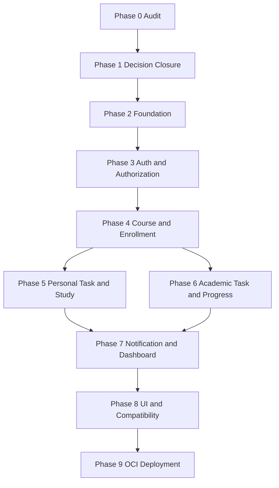

# 10 — IMPLEMENTATION PLAN

| Metadata | Value |
|---|---|
| Document ID | DOC-10 |
| Version | 1.4.0 |
| Status | Draft |
| Strategy | Incremental Laravel Full-Stack delivery |

## 1. Purpose

Defines implementation order, dependencies, deliverables, and approval gates. This plan does not authorize implementation of unresolved scope.

## 2. Delivery principles

- Start with repository and environment audit.
- Preserve approved business rules.
- Close schema and permission blockers before feature implementation.
- Implement server-side authorization before relying on UI.
- Use migrations, seeders, factories, and automated tests.
- Keep one Laravel application.
- Do not build a separate API unless a documented requirement needs it.
- Keep all secrets outside source control.
- Deploy incrementally to staging before production.

## 3. Phases

### Phase 0 — Baseline and repository audit
Deliverables:
- current repository inventory;
- Laravel/PHP/MySQL/runtime version audit;
- existing schema and migrations audit;
- mapping from old Android-oriented docs to web baseline;
- list of obsolete mobile artifacts to archive;
- risk and blocker register.

Exit gate:
- user approves audit findings and target repository structure.

### Phase 1 — Decision closure and design freeze
Tasks:
- finalize account/profile mapping;
- confirm registration fields and validation;
- finalize temporary password lifecycle;
- finalize course authority matrix;
- finalize personal-task ownership policy;
- finalize notification schedule/preferences;
- finalize DB schema, archive behavior, and concurrency matrix;
- set numeric NFR targets.

Deliverables:
- approved PRD/SRS;
- approved ERD/DDL;
- route and policy matrix;
- updated UI/UX and design tokens.

Exit gate:
- explicit approval before migrations or feature code.

### Phase 2 — Environment and application foundation
Tasks:
- create Laravel application;
- configure environment variables;
- configure MySQL connection;
- configure Bootstrap assets;
- establish Blade layouts;
- configure logging and exception handling;
- set up test runner and CI checks.

Deliverables:
- application boots locally;
- database migrations run in test environment;
- guest and authenticated layouts;
- initial test suite.

Exit gate:
- baseline tests and build pass.

### Phase 3 — Authentication and authorization
Tasks:
- student registration;
- username/password login;
- Laravel sessions;
- logout;
- account status checks;
- Admin bootstrap;
- lecturer account provisioning;
- temporary password workflow;
- policies and role middleware.

Deliverables:
- tested auth journeys;
- complete role/resource authorization tests.

Exit gate:
- no critical authorization bypass.

### Phase 4 — Master data and enrollment
Tasks:
- student and lecturer profile management;
- course CRUD/archive;
- course-to-lecturer assignment;
- enrollment create/reactivate/cancel/complete;
- period uniqueness and transactions.

Deliverables:
- admin and lecturer course/enrollment screens;
- tests for duplicate and reactivation behavior.

Exit gate:
- enrollment rules and permissions pass.

### Phase 5 — Personal task and study activity
Tasks:
- personal task CRUD/archive/history;
- optional course relation;
- study activity CRUD/archive/history;
- filters, pagination, and responsive views.

Deliverables:
- Mahasiswa task and study modules;
- ownership and validation tests.

Exit gate:
- no cross-user data access.

### Phase 6 — Academic tasks and progress
Tasks:
- academic task create/edit/close;
- distribution at creation;
- late enrollment distribution;
- idempotency;
- progress update;
- lecturer monitoring and correction;
- Admin read-only monitoring.

Deliverables:
- academic task workflows;
- race-condition and integration tests.

Exit gate:
- no duplicate/reset progress and no role leakage.

### Phase 7 — Notifications and dashboard
Tasks:
- notification persistence and inbox;
- unread/read state;
- deduplication;
- Laravel Scheduler;
- dashboard summaries;
- notification settings only if approved.

Deliverables:
- web notifications;
- scheduler operational checks.

Exit gate:
- duplicate notification tests and scheduler tests pass.

### Phase 8 — UI polish and compatibility
Tasks:
- Light/Dark theme;
- responsive sidebar/offcanvas;
- browser compatibility;
- accessibility review;
- form, empty, loading, error states;
- performance measurement and query optimization.

Deliverables:
- release candidate UI;
- browser test report.

Exit gate:
- acceptance review on supported browsers and viewport sizes.

### Phase 9 — OCI deployment and operations
Tasks:
- provision one OCI VM;
- configure OS and firewall;
- install Nginx, PHP runtime/extensions, MySQL;
- deploy Laravel;
- configure HTTPS;
- configure scheduler/worker if needed;
- configure external backup;
- test restore;
- configure monitoring and logs;
- document rollback.

Deliverables:
- staging/production deployment evidence;
- operations runbook;
- backup/restore test evidence.

Exit gate:
- production readiness approval.

## 4. Dependency order

## 5. Governance checkpoints

| Checkpoint | Required approval |
|---|---|
| CP0 | Repository audit and preservation strategy |
| CP1 | Product/business decisions and scope |
| CP2 | Database schema and concurrency |
| CP3 | Authentication and permission matrix |
| CP4 | Feature acceptance before next module |
| CP5 | Staging and security review |
| CP6 | Production deployment and rollback readiness |

No code or schema migration should cross a checkpoint that requires explicit approval without receiving it.

## 6. Risk register

| Risk | Impact | Mitigation |
|---|---|---|
| Legacy mobile requirements remain in docs | Conflicting implementation | Mark historical/remove from active baseline with traceability |
| Admin privilege overreach | Privacy breach | Dedicated monitoring query and negative tests |
| Duplicate progress | Incorrect task state | Unique key, transaction, idempotent insert |
| Concurrent enrollment/distribution | Missing/duplicate progress | Race tests and transaction design |
| Temporary password exposure | Account compromise | One-time display, expiry/forced change policy TBD, no logging |
| Single VM failure | Service outage | External backup and tested restore |
| ARM64 dependency incompatibility | Deployment failure | Verify PHP extensions and dependencies before provisioning |
| Scheduler not running | Missed reminders | Health checks and operational monitoring |
| Undefined NFR targets | Unmeasurable acceptance | Agree thresholds before release |

## 7. Initial release acceptance

MVP release requires:
- all MUST requirements implemented;
- critical role and ownership tests pass;
- task distribution is idempotent;
- enrollment history preserved;
- notifications deduplicated;
- responsive pages work on selected modern browsers;
- HTTPS and secure session configuration;
- tested external backup and restore;
- documented deployment and rollback.

## 8. Open implementation decisions

- Repository location and current state.
- Laravel/PHP/MySQL/Bootstrap versions.
- E2E tooling.
- CI provider.
- Queue worker requirement.
- OCI region/shape availability.
- Backup target/retention.
- Monitoring and alerting tools.
- Final NFR thresholds.

## 9. Status pelaksanaan

| Tanggal | Tahap | Hasil | Gate |
|---|---|---|---|
| 2026-11-18 | Phase 0 — audit | Repository hanya berisi dokumentasi (tanpa kode, tanpa git). PHP 8.4.24, Composer 2.10.3, Node 20.20.2, MariaDB 11.8.5 lokal. | Menunggu persetujuan temuan |
| 2026-11-18 | Phase 1 — rekonsiliasi | Seluruh REC-01 s.d. REC-15 dan PRD-TBD-016/022/023/024 disetujui (`USER-DECIDED`). | Disetujui |
| 2026-11-18 | Phase 3 — auth | Registrasi mahasiswa, login/logout session, rate limit login, cek akun aktif, middleware role, perubahan password, bootstrap admin via Artisan, provisioning dosen + temporary password sekali tampil. 32 test lulus (110 assertion). | Baseline lulus, menunggu review |
| 2026-11-18 | Phase 4 — master data | Mata kuliah (CRUD, arsip, penugasan dosen), enrollment (create/reactivate/status transition, unique periode), akun mahasiswa dan dosen oleh Admin (daftar, detail, nama, status, temporary password), daftar mata kuliah untuk dosen dan mahasiswa. | Selesai |
| 2026-11-18 | Konflik edit & mata kuliah dosen | `row_version` pada tugas, aktivitas belajar, dan mata kuliah; dosen dapat mengubah nama mata kuliah yang diampu; konflik ditolak dengan pesan dan input lama dipertahankan. | Selesai |
| 2026-11-18 | Phase 5 — tugas personal & belajar | Tugas personal CRUD/arsip/riwayat, aktivitas belajar CRUD/arsip/riwayat, filter dan pagination, scoping kepemilikan, modal konfirmasi arsip. 74 test lulus (275 assertion). | Baseline lulus, menunggu review |
| 2026-11-18 | Phase 2 — foundation | Laravel 12.73.0 (PHP 8.4.24) + Bootstrap 5.3.9 + Bootstrap Icons 1.13.2 via Vite; layout guest/app dengan sidebar + offcanvas; token light/dark; 4 test baseline lulus. Versi berstatus `PROPOSED` (REC-15). | Baseline lulus, menunggu review |

Catatan: Phase 2 tidak membuat tabel domain. Migration bawaan framework hanya dipakai untuk memverifikasi koneksi database pengembangan dan tetap akan direkonsiliasi pada CP2. Deployment produksi, migration final, dan keputusan schema tetap memerlukan persetujuan eksplisit.
