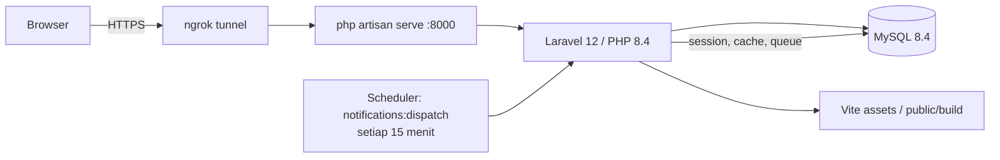
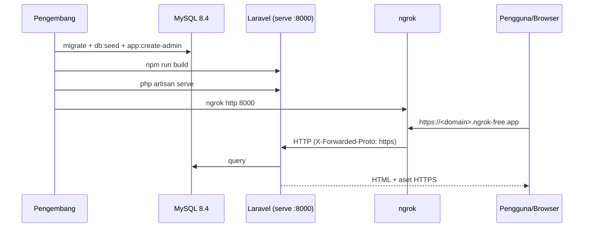

# LAPORAN TEKNIS

## Aplikasi Manajemen Tugas dan Belajar Mahasiswa

| Metadata | Nilai |
|---|---|
| Nama aplikasi | Manajemen Tugas dan Belajar Mahasiswa |
| Platform | Web Application (Laravel Full-Stack) |
| Versi aplikasi | 1.10.0 (Phase 8 selesai) |
| Framework | Laravel 12.73.0, PHP 8.4.24 |
| Database | MySQL 8.4 LTS |
| Frontend | Blade, Bootstrap 5.3.9, Bootstrap Icons 1.13.2, Vite |
| Deployment | Simulasi lokal + tunnel ngrok (HTTPS) |
| Penyusun | (isi nama/nim) |
| Tanggal | 19 November 2026 |

---

## 1. Ringkasan eksekutif

Aplikasi ini adalah sistem manajemen tugas dan belajar mahasiswa berbasis web
yang mendukung tiga peran: Mahasiswa, Guru/Dosen, dan Admin. Mahasiswa mengelola
tugas personal dan aktivitas belajar; Guru/Dosen membuat tugas akademik dan
memantau progres; Admin mengelola akun, mata kuliah, dan enrollment.

Pengembangan dilakukan bertahap (Phase 0–8) dengan pendekatan test-driven.
Seluruh 134 test (561 assertion) lulus pada SQLite in-memory dan MySQL 8.4.13.
Audit aksesibilitas (axe-core, WCAG A/AA) pada seluruh halaman tiga peran
menghasilkan 0 violation. Deployment dilakukan sebagai simulasi lokal yang
diekspos lewat tunnel ngrok dengan HTTPS, sesuai instruksi tugas.

## 2. Arsitektur sistem

### 2.1 Komponen



### 2.2 Lapisan aplikasi

| Lapisan | Isi |
|---|---|
| Presentasi | Blade view, Bootstrap 5, komponen `.app-card`, `.app-sidebar` |
| Routing | `routes/web.php` (web routes + middleware role) |
| Controller | `DashboardController`, `PersonalTaskController`, `AcademicTaskController` (student/lecturer/admin), `StudyActivityController`, `AccountController`, `NotificationController` |
| Otorisasi | Policy/Gate (`app/Policies/`) untuk tiap resource utama, middleware `role` |
| Layanan | `AcademicTaskService`, `PersonalTaskService`, `EnrollmentService`, `NotificationService`, `AccountArchiveService` |
| Data | Eloquent model + 14 migrasi (users, mahasiswa, guru_dosen, mata_kuliah, enrollment, tugas, progres, aktivitas belajar, notifikasi, dll.) |

### 2.3 Model data (ringkas)

Entitas utama: `User` (role: mahasiswa/guru_dosen/admin), `Mahasiswa`, `GuruDosen`,
`MataKuliah`, `Enrollment`, `Tugas` (personal/academic), `ProgresTugasAkademik`,
`AktivitasBelajar`, `Notifikasi`, `Prioritas`, `StatusTugas`, `StatusBelajar`.

Relasi kunci: `User` 1–1 `Mahasiswa`/`GuruDosen`; `GuruDosen` 1–N `MataKuliah`;
`MataKuliah` N–M `Mahasiswa` via `Enrollment`; `Tugas` academic 1–N `ProgresTugasAkademik`.

## 3. Alur deployment (simulasi)



### 3.1 Langkah ringkas

1. `composer install`, `cp .env.example .env`, `php artisan key:generate`.
2. `npm install && npm run build`.
3. Isi `.env` (database, `APP_URL`, `TRUSTED_PROXIES=*`, `SESSION_SECURE_COOKIE=true`).
4. `php artisan migrate && php artisan db:seed`.
5. `php artisan app:create-admin admin`.
6. `php artisan serve --host=127.0.0.1 --port=8000`.
7. `ngrok http 8000`, samakan `APP_URL` dengan domain ngrok, `php artisan config:clear`.
8. (Opsional) `php artisan schedule:work` untuk demo notifikasi.

Detail lengkap: `docs/11_DEMO_DEPLOYMENT.md`.

## 4. Konfigurasi database dan environment

### 4.1 Tabel (14 migrasi)

`users`, `mahasiswa`, `guru_dosen`, `mata_kuliah`, `enrollment`, `tugas`,
`tugas_akademik_progress`, `aktivitas_belajar`, `notifikasi`, `prioritas`,
`status_tugas`, `status_belajar`, `sessions`, `cache` (bawaan Laravel).

### 4.2 Variabel environment kunci

| Variabel | Contoh (demo) | Catatan |
|---|---|---|
| `APP_URL` | `https://abc.ngrok-free.app` | Harus sama dengan domain tunnel; salah → 419/redirect loop. |
| `DB_CONNECTION` | `mysql` | |
| `DB_HOST/PORT/DATABASE` | `127.0.0.1 / 3306 / db_manajemen_akademik` | |
| `SESSION_DRIVER` | `database` | |
| `SESSION_SECURE_COOKIE` | `true` | Hanya bila seluruh akses via HTTPS. |
| `TRUSTED_PROXIES` | `*` (demo) / IP Nginx (produksi) | Agar `X-Forwarded-Proto` dipercaya. |
| `CACHE_STORE` | `database` | |
| `QUEUE_CONNECTION` | `database` | |

Kredensial database asli tidak disertakan di repositori; `.env` di-ignore oleh git.

## 5. Keamanan

| Aspek | Implementasi |
|---|---|
| Autentikasi | Laravel Session Authentication, password di-hash (bcrypt). |
| Otorisasi | Policy/Gate untuk tiap resource utama; middleware `role` membatasi rute per peran. |
| CSRF | Token CSRF pada semua form POST/PUT/PATCH/DELETE. |
| Rate limit login | 5 percobaan per menit per throttle key (`LoginRequest`). |
| Akun nonaktif | Middleware `EnsureAccountIsActive` memblokir akses. |
| Password sementara | Wajib ganti password + kedaluwarsa 72 jam. |
| Cookie sesi | `Secure` (demo HTTPS), `HttpOnly`, `SameSite=Lax`. |
| Proxy/HTTPS | `TRUSTED_PROXIES` + `SESSION_SECURE_COOKIE`; tidak mempercayai proxy bila env kosong. |
| Arsip akun | Akun diarsipkan dinonaktifkan; dosen hanya dapat diarsipkan tanpa mata kuliah aktif; restore tidak membackfill progres. |
| Kebocoran resource | Resource milik pengguna lain mengembalikan 404 (bukan 403) agar keberadaannya tidak terbocorkan. |
| Optimistic locking | `row_version` pada tugas, aktivitas belajar, mata kuliah, dan progres akademik. |

## 6. Backup, monitoring, dan rollback

| Aspek | Prosedur (demo) |
|---|---|
| Backup database | `mysqldump -u<user> -p db_manajemen_akademik > backup-$(date +%F).sql` |
| Restore | `mysql -u<user> -p db_manajemen_akademik < backup-YYYY-MM-DD.sql` |
| Monitoring | `tail -f storage/logs/laravel.log`, `php artisan about`, endpoint `/up` |
| Rollback kode | `git log --oneline` → `git checkout <commit>` (tanpa menghapus database) |
| Rollback migrasi | `php artisan migrate:rollback --step=1` setelah backup |

Untuk produksi, prosedur ini diganti dengan backup terjadwal, monitoring eksternal,
dan rollback rilis di VM (lihat `docs/10_IMPLEMENTATION_PLAN.md` Phase 9).

## 7. Hasil pengujian

### 7.1 Ringkasan

| Item | Nilai |
|---|---|
| Total test | 134 |
| Assertion | 561 |
| Database uji | SQLite in-memory dan MySQL 8.4.13 |
| Hasil | Semua lulus |

### 7.2 Tiga skenario utama

#### Skenario 1 — Autentikasi dan pembatasan role
- Login mahasiswa → masuk `/mahasiswa/dashboard`.
- Akses `/admin/dashboard` sebagai mahasiswa → ditolak.
- Login dosen → `/guru-dosen/dashboard`; login admin → `/admin/dashboard`.
- **Hasil:** lulus (otorisasi server-side, bukan hanya UI).

#### Skenario 2 — Tugas personal: buat, tampilkan, arsip, riwayat
- Buat tugas → tampil di daftar dan dashboard.
- Arsip → hilang dari daftar aktif.
- Buka riwayat → tugas arsip tetap terlihat.
- **Hasil:** lulus.

#### Skenario 3 — Tugas akademik: distribusi, progres, koreksi, notifikasi
- Dosen membuat tugas → progres terdistribusi ke mahasiswa terdaftar.
- Mahasiswa mengubah status → tersimpan dengan tanggal dan aktor.
- Dosen mengoreksi → berhasil; mahasiswa terkunci setelah tugas ditutup.
- Notifikasi distribusi tampil di `/notifications` dan badge unread berkurang.
- **Hasil:** lulus.

### 7.3 Aksesibilitas
- Audit Playwright + axe-core pada seluruh halaman tiga peran, Light/Dark,
  desktop 1280px dan mobile 390px → **0 violation** (WCAG A/AA).
- Smoke test kompatibilitas lulus di Chromium dan Firefox.
- WebKit/Safari tidak dapat diuji karena library host tidak tersedia (dicatat sebagai
  keterbatasan).

## 8. Dokumentasi cara menjalankan aplikasi

Lihat `docs/11_DEMO_DEPLOYMENT.md` dan bagian "Menjalankan aplikasi (demo)" pada
`README.md`. Ringkas:

```bash
composer install
cp .env.example .env
php artisan key:generate
npm install && npm run build
php artisan migrate && php artisan db:seed
php artisan app:create-admin admin
php artisan serve --host=127.0.0.1 --port=8000
# opsional untuk akses publik:
ngrok http 8000
```

## 9. Bukti screenshot

Bukti dikumpulkan sebagai screenshot (tanpa video) sesuai `docs/14_SCREENSHOT_CHECKLIST.md`.
Daftar minimal: halaman login, dashboard tiap peran, daftar tugas personal,
form buat tugas, arsip/riwayat, tugas akademik, halaman progres, inbox notifikasi,
halaman appearance Light/Dark, dan URL ngrok di address bar.

## 10. Prompt AI dan verifikasi

Ringkasan prompt, hasil analisis, dan verifikasi mandiri ada di
`docs/12_AI_PROMPT_LOG.md`. Setiap perubahan kode diverifikasi dengan test
otomatis dan, bila menyentuh UI, dengan audit Playwright/axe-core.

## 11. Keterbatasan

1. Deployment adalah simulasi lokal + tunnel ngrok, bukan server produksi.
   Tautan hanya aktif selama demo berjalan.
2. Paket gratis ngrok menampilkan halaman peringatan dan memiliki kuota terbatas.
3. Browser WebKit/Safari tidak diuji karena keterbatasan library host.
4. Timezone form deadline belum dikonversi dari `Asia/Jakarta` (di luar scope
   Phase 8; dicatat sebagai catatan, belum diperbaiki).
5. Backup/monitoring/rollback yang didokumentasikan masih prosedur lokal.
